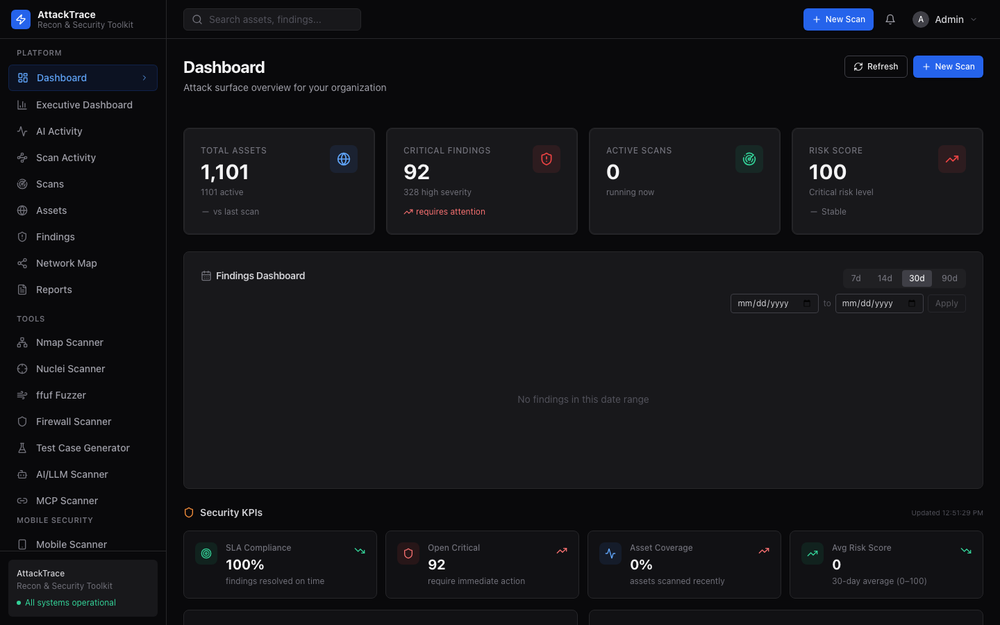
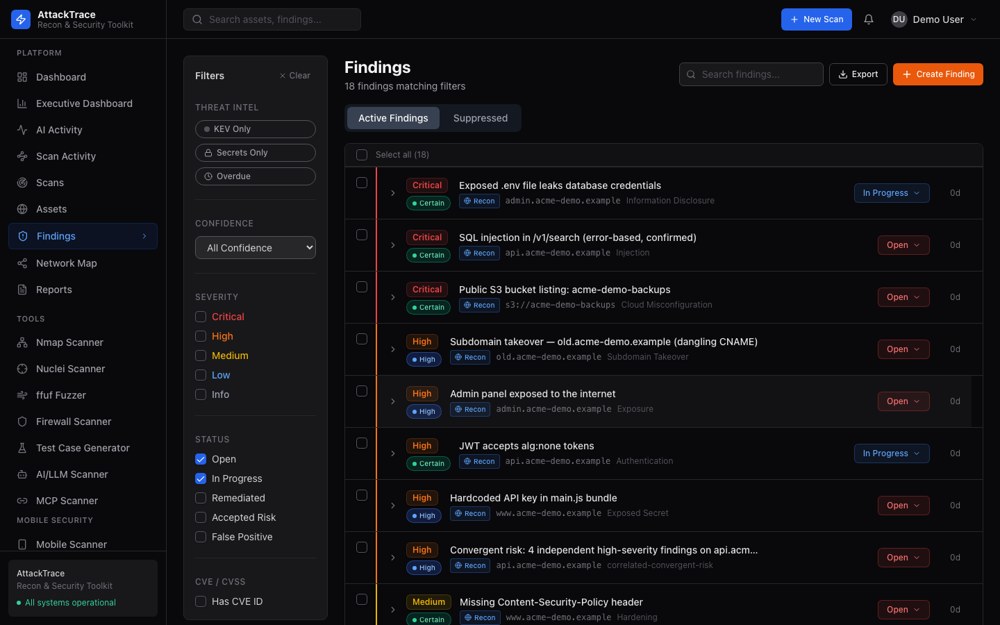
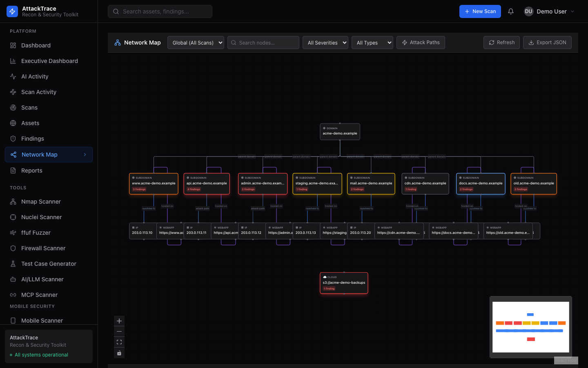
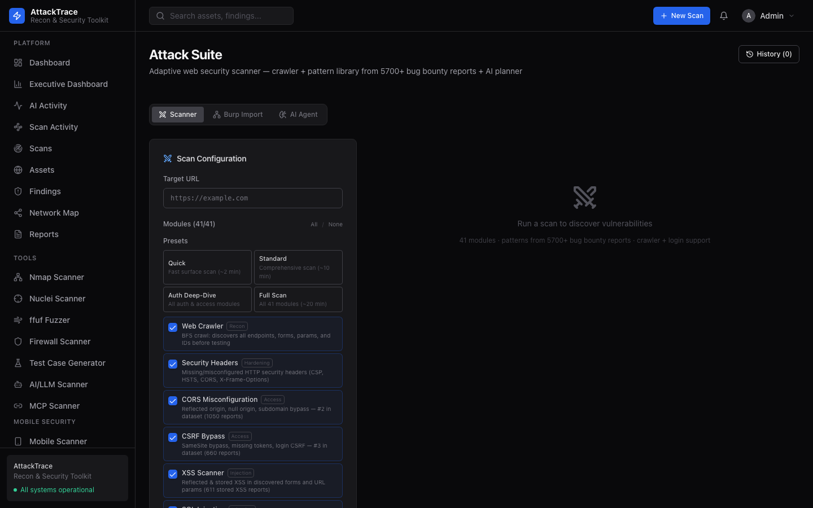
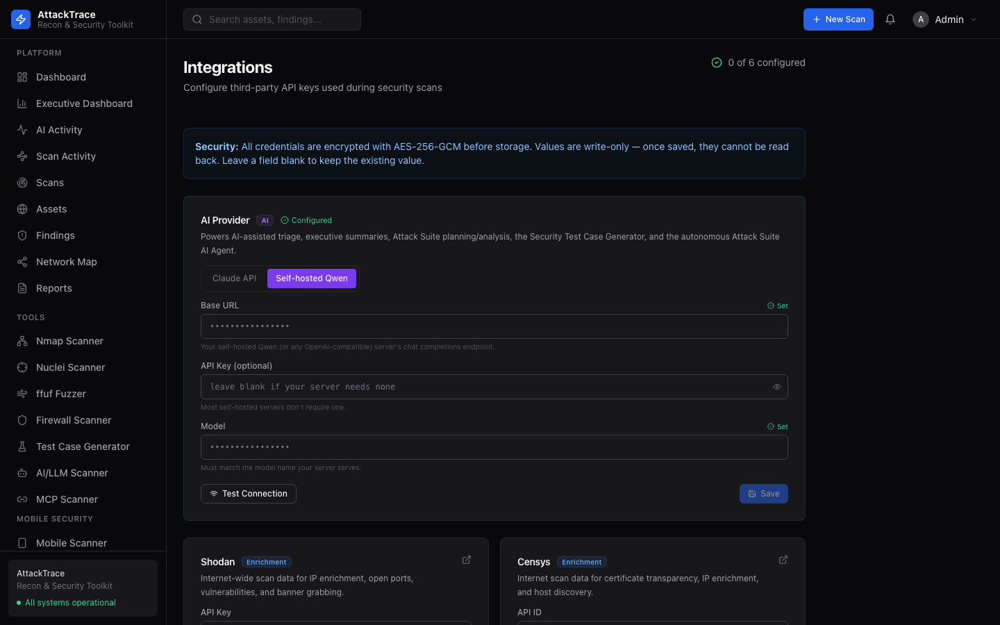
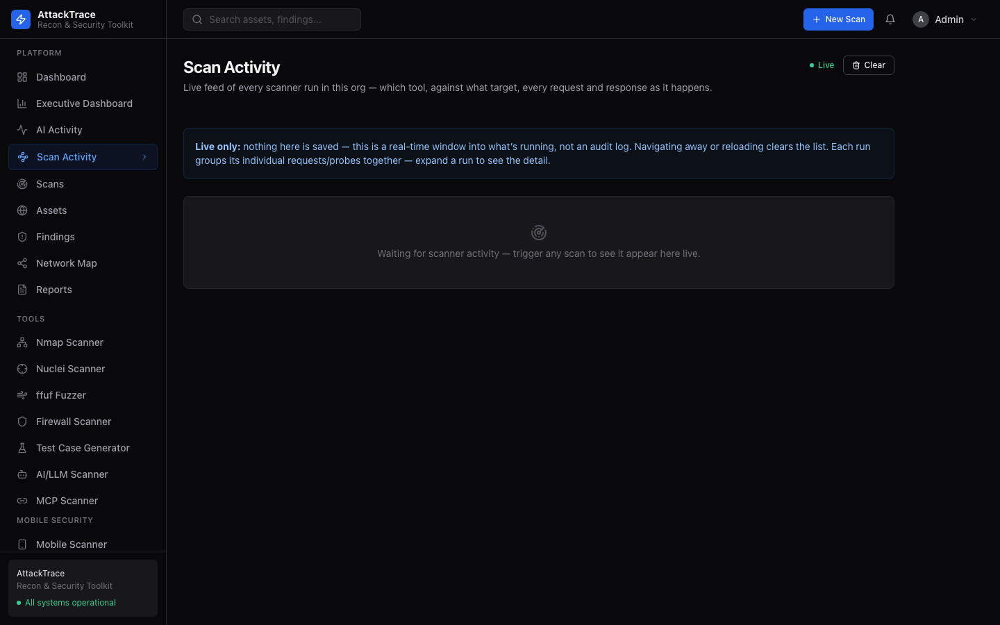
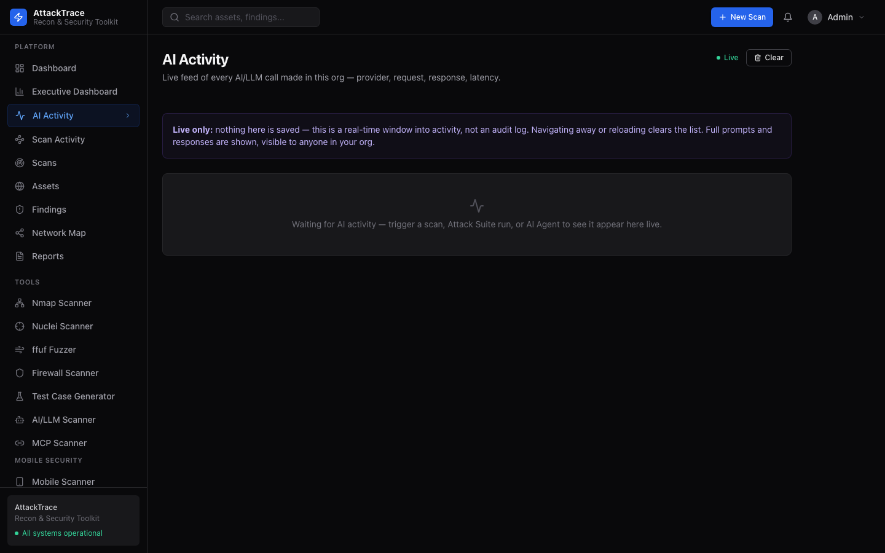

<p align="center">
  
</p>

<p align="center">
  
  
  
  
  
  
  
</p>

<h1 align="center">AttackTrace</h1>

<p align="center">
  <b>External Attack Surface Management &amp; Security Testing Platform</b>
</p>

<p align="center">
  AttackTrace is a full-stack security platform for external attack surface discovery, vulnerability scanning, AI-powered triage, and collaborative finding management. Point it at a domain and get a complete picture of your external footprint — subdomains, exposed services, vulnerabilities, cloud assets, mobile apps, and more.
</p>

---

## Platform Preview

<p align="center">
  
</p>

<details>
<summary><b>More Screenshots</b></summary>

### Findings — severity, confidence, status workflow
<p align="center">
  
</p>

### Network Map — domain → subdomain → IP → web app
<p align="center">
  
</p>

### Attack Suite — 41 modules, presets, AI Agent tab
<p align="center">
  
</p>

### AI Provider — Claude API or self-hosted Qwen
<p align="center">
  
</p>

### Live Scan Activity
<p align="center">
  
</p>

### Live AI Activity
<p align="center">
  
</p>

</details>

---

## What AttackTrace Does

| | |
|---|---|
| 🔍 **Discover** | Enumerate subdomains, IPs, web apps, cloud buckets, and employee identities from a single domain |
| 🛡️ **Scan** | Run Nuclei, Nmap, ffuf, WAF detection, and custom attack modules against discovered assets |
| 📊 **Track** | Unified findings dashboard across recon, manual, and mobile scans — with KEV/EPSS enrichment |
| 🤖 **Triage** | Claude or self-hosted Qwen auto-classifies severity, detects false positives, generates PoC and remediation tickets |
| 🗺️ **Map** | Visualize attack paths with MITRE ATT&CK mapping, APT group intelligence, and network graphs |
| 📱 **Mobile** | Static + dynamic analysis of APK/IPA files with findings federated into the central dashboard |
| 👥 **Collaborate** | Multi-tenant, role-based access for pentest teams with audit logging and ticket integration |

---

## Features

### Platform Dashboard & Findings

| Feature | Description |
|---|---|
| **Findings Dashboard** | Stacked severity bar chart with 7d / 14d / 30d / 90d presets and custom date range picker |
| **Risk Creation** | Manually create findings with full details — title, severity, category, affected asset, evidence, CVEs, CVSS, remediation, ticket ref; shows alongside scan findings |
| **Inline Severity Edit** | Click any severity badge in the findings list to instantly adjust severity via PATCH |
| **Finding Sources** | Source badges distinguish Recon (scan), Mobile (MSRA), and Manual findings in one unified view |
| **KEV / EPSS Enrichment** | CISA Known Exploited Vulnerabilities status + FIRST.org EPSS scores on every finding |
| **Suppression Rules** | Org-scoped, pattern-matched, expiry-aware suppression rules applied during scan ingestion |
| **Deduplication** | SHA-256 dedup hash prevents duplicate findings within the same scan |
| **Finding Workflow** | Status lifecycle: Open → In Progress → Remediated / Accepted Risk / False Positive |
| **Notification Bell** | Live scan status notifications in the topbar — unread badge, click-to-navigate, 30s polling |
| **Scan Event Replay** | Redis-backed event buffer replays progress on reconnect — no reset to 0% on nav back |
| **Partial Persistence** | Scan worker persists module results incrementally — no data loss if a scan crashes mid-way |

### Scan Engine (24 Modules)

| Category | Modules |
|---|---|
| **Seed** | WHOIS, ASN/IP range discovery, certificate transparency |
| **Domain** | Subdomain enumeration (wordlist + CT), DNS resolution |
| **Infrastructure** | Port scanner (100+ ports), service/banner detection |
| **Web** | HTTP probing, tech fingerprinting (60+ signatures), Playwright screenshots of all alive apps |
| **Cloud** | AWS S3, Azure Blob, GCP bucket enumeration |
| **OSINT** | GitHub recon, employee discovery, breach/credential detection |
| **Threat Intel** | Shodan, Censys, SecurityTrails, AlienVault OTX, GreyNoise, URLScan, PassiveTotal |
| **Enrichment** | CVE/CVSS from NVD, CISA KEV status, FIRST.org EPSS scores, priority scoring |

### Platform Highlights (latest)

| Feature | Description |
|---|---|
| **Multi-provider AI** | Switch between the Claude API and a self-hosted OpenAI-compatible model (e.g. Qwen) in Settings → Integrations; one seam (`llm_client.py`) serves every AI feature |
| **Live AI Activity** | Real-time feed of every AI call platform-wide — feature, model, full prompt/response, latency (live-only, nothing persisted) |
| **Live Scan Activity** | Real-time feed across every scanner — which tool, which target, each request/probe, grouped by run |
| **Cross-scanner Correlation** | Groups open findings by asset and synthesizes compound CRITICAL/HIGH findings (e.g. takeover + exposed service, secret + live service, KEV + admin port), always linking back to the real constituent findings |
| **Confidence Grading** | False-positive gate in code: confidence derived from the verification oracle (differential, timing, extracted value, …) with a plain-English explanation on each finding |
| **Professional Reports** | HTML/PDF assessment reports: executive summary, overall risk rating, top remediation priorities ranked by KEV → EPSS → CVSS, per-finding evidence and remediation |
| **Aggressive-scan Auto-chain** | Aggressive scans automatically follow up with Nuclei, secrets, JS scanner and takeover checks |
| **Unified Findings** | ~40 scanners (cloud, container, IaC, email, supply chain, MCP, API, AI/LLM, mobile…) ingest into one deduplicated, org-scoped findings table |

### Security Tools

| Tool | Description |
|---|---|
| **Nmap Scanner** | 7 scan types (Quick, Full Port, Service Version, OS Detection, Stealth SYN, Aggressive, Custom), timing T0–T5, parsed host/port table, raw output, export, scan history |
| **Nuclei Scanner** | 3-mode template selector (All / Categories / Specific), severity filter, live streaming progress, CVE enrichment, export JSON/CSV/Markdown, scan history |
| **ffuf Fuzzer** | Bundled / SecLists / custom wordlist modes, live progress log, results table with status/size/words/lines, base64-decoded FUZZ inputs, scan history |
| **Firewall & WAF Scanner** | 4 tabs: WAF Detection (10 vendors, confidence score), WAF Bypass Probe (13 evasion techniques, live SSE), Port Firewall Mapper (5 nmap modes), Rule Analyzer (iptables/Cisco ACL/pfSense XML); scan history persisted in localStorage |
| **Attack Suite** | 41-module adaptive web scanner — crawl, headers, CORS, CSRF, XSS, SQLi, SSRF, IDOR, JWT, GraphQL (incl. schema-driven deep testing), NoSQL, SSTI, XXE, deserialization, file upload, host-header, OAuth, type confusion, API versioning, and more. Every finding's confidence is graded server-side from the oracle that confirmed it |
| **Custom Detection Templates** | Declarative YAML checks (`app/scanner_templates/*.yaml`) run alongside the built-in modules — add new detections without touching Python |
| **AI Agent** | Autonomous, tool-using pentest agent. Strictly scope-enforced to your org's assets, fixed non-destructive tools, provider-aware budget cap, full audit trail, and a kill switch |
| **PHP2Shell Scanner** | Give it IPs, CIDRs or hostnames; fingerprints PHP on each web port (X-Powered-By/Server, exposed `phpinfo()` incl. SAPI and `session.upload_progress`) and flags hosts vulnerable to the Oct-2026 unauthenticated PHP RCE (CVE-2026-109618 / CVE-2026-109619, CISA KEV). Judged against the fixed releases with honest verdicts — vulnerable / likely vulnerable / distro backport unverified / version hidden / patched. Sends no exploit traffic. **Add from assets** pulls IPs/domains/subdomains/web apps from your inventory into the target list; **HTML / PDF / CSV reports** cover every scanned target joined to the asset inventory (including ones where nothing answered) |
| **Takeover Checker** | CNAME chain analysis, 42+ service fingerprints, NS/MX takeover detection |
| **Attack Path Mapper** | MITRE ATT&CK path mapping for AD/AWS/Azure/GCP; APT Groups browser (187 threat actors with country attribution and MITRE descriptions); CVE correlation; intel sync with 26k+ items |
| **Network Map** | Interactive WebGL graph (xyflow); severity-colored nodes; domain→subdomain→IP→webapp hierarchy; attack path animation; scan selector; node detail panel with actions |
| **Mobile Scanner (MSRA)** | APK/IPA/JAR static analysis, AI-driven dynamic analysis, Claude PoC generation, findings federation into central dashboard |
| **Test Case Generator** | 169 test cases across 18 categories (Authorization, Injection, Deserialization, Business Logic, API, Cloud, Mobile, and more) sourced from HackerOne/Bugcrowd reports, PortSwigger, OWASP WSTG; Standard or AI-Assisted mode |

### AI Features (Claude or self-hosted Qwen)

| Feature | Description |
|---|---|
| **Finding Triage** | Auto-classify severity, detect false positives, assign confidence score |
| **Executive Summary** | 3-bullet non-technical scan summary with risk posture and next steps |
| **Jira Ticket Generator** | Structured remediation tickets with acceptance criteria and effort estimate |
| **NL Search** | Natural-language query translation to structured asset/finding filters |
| **AI Test Cases** | Customized security test cases based on target, stack, and threat model |
| **Mobile PoC** | Claude generates proof-of-concept exploit code for mobile findings |

### Team & Access

| Feature | Description |
|---|---|
| **Multi-tenancy** | Complete organization isolation — scans, assets, findings, credentials, and API keys are org-scoped |
| **Roles** | Owner / Admin / Analyst / Viewer with enforced permissions at every API endpoint |
| **Team Management** | Direct user creation or shareable invite link (permanent, self-service, Analyst role) |
| **API Keys** | Generate platform API keys for CI/CD pipelines and custom integrations |
| **Integrations** | Shodan, Censys, SecurityTrails, GitHub, AlienVault OTX, PassiveTotal, Jira, Slack — all encrypted AES-256-GCM |
| **Audit Log** | Immutable record of every platform action — user, action type, before/after state, IP address, CSV export |

---

## Stack

| Layer | Technology |
|---|---|
| **Backend** | FastAPI + SQLAlchemy (async) + Alembic migrations |
| **Frontend** | Next.js 15 + React 19 + Tailwind CSS + shadcn/ui + TanStack Query |
| **Task Queue** | Celery + Redis (3 queues: `default`, `scans`, `ai`) + Celery Beat watchdog |
| **Database** | PostgreSQL 16 |
| **AI** | Anthropic Claude (claude-haiku-4-5 default, configurable) |
| **Scan Engine** | AttackTrace Python CLI + nuclei + ffuf + nmap + Playwright |
| **Monitoring** | Celery Flower at `/flower` |
| **Deployment** | Docker Compose (dev/prod) · Kubernetes + KEDA autoscaling (prod) |

---

## Installation

Two options — native (recommended for local dev) or Docker.

---

### Option A — Native (no Docker)

**Prerequisites:** Python 3.11+, Node.js 18+, PostgreSQL 14+, Redis 7+

<details>
<summary><b>macOS (Homebrew)</b></summary>

```bash
brew install python@3.11 node postgresql@16 redis
brew services start postgresql@16
brew services start redis
```
</details>

<details>
<summary><b>Ubuntu / Debian / Kali</b></summary>

```bash
sudo apt update
sudo apt install -y python3.11 python3.11-venv nodejs npm postgresql redis-server
sudo systemctl start postgresql redis-server
```
</details>

**Clone and start:**

```bash
git clone https://github.com/SJ-Source-Sink/AttackTrace.git
cd AttackTrace
chmod +x start.sh && ./start.sh
```

`start.sh` handles everything automatically:
1. Creates a Python virtual environment and installs all backend dependencies
2. Installs frontend Node modules
3. Generates a `.env` with random secrets
4. Creates the `attacktrace` PostgreSQL database and user
5. Runs all Alembic database migrations
6. Seeds the default admin account
7. Starts: FastAPI backend, Celery worker, Celery beat, Next.js dev server
8. Starts the MSRA mobile sidecar if found on the system

**Stop:**
```bash
./stop.sh   # or: make stop
```

**View logs:**
```bash
make native-logs         # tail all services
tail -f logs/backend.log
tail -f logs/worker.log
tail -f logs/frontend.log
```

---

### Option B — Docker

**Prerequisites:** [Docker Desktop](https://docs.docker.com/get-docker/)

```bash
git clone https://github.com/SJ-Source-Sink/AttackTrace.git
cd AttackTrace
chmod +x setup.sh && ./setup.sh
```

Or:
```bash
make setup
```

`setup.sh` builds all images, starts Postgres + Redis, runs migrations, seeds the admin account, and starts all services in one command.

**Stop:**
```bash
make down
```

---

### First Login

Open **http://localhost:3000**

| Field | Value |
|---|---|
| Username | `admin` |
| Password | `admin` |

> Change the default password immediately via **Settings → Profile**.

---

### Install Scanning Tools

To use Nuclei, ffuf, Nmap, and SecLists:

```bash
make install-tools
```

Installs on macOS (Homebrew) and Linux (apt + go install):
- `nuclei` + nuclei-templates (~10,000 templates)
- `ffuf`
- `nmap`
- `gowitness` (screenshots)
- `SecLists`
- Playwright Chromium (web screenshots during scans)

---

### Enable AI Features

Add your Anthropic API key to unlock finding triage, executive summaries, AI Attack Suite, and mobile PoC generation.

**Native:** Add to `platform/backend/.env`:
```
ANTHROPIC_API_KEY=sk-ant-...
```

**Docker:** Add to `.env` at repo root, then `make restart`.

The platform runs fully without an API key — AI features are gracefully skipped.

---

## Updating

**Native:**
```bash
git pull && ./start.sh
```

**Docker:**
```bash
make update
```

Both automatically detect which services changed, rebuild only those, and run any new database migrations.

---

## Common Commands

```bash
# ── Native ──────────────────────────────────────
make start              # Start all services
make stop               # Stop all services
make native-logs        # Tail all service logs

# ── Docker ──────────────────────────────────────
make setup              # First-time Docker setup
make up                 # Start containers
make down               # Stop containers
make update             # Pull + rebuild + migrate + restart
make logs               # Tail all container logs
make ps                 # Container status

# ── Database ────────────────────────────────────
make migrate            # Run pending Alembic migrations
make seed               # Re-run initial data seed
make db-shell           # PostgreSQL interactive shell

# ── Development ─────────────────────────────────
make backend-logs       # Backend logs only
make worker-logs        # Worker logs only
make backend-shell      # Shell inside backend container
make lint               # ruff + mypy on backend
make test-backend       # Full pytest suite with coverage
make install-tools      # Install nuclei, ffuf, nmap, etc.
```

---

## Third-Party Integrations

Configure at **Settings → Integrations** (all credentials encrypted AES-256-GCM):

| Service | Used for |
|---|---|
| **Shodan** | Open ports, CVEs, service banners per IP |
| **Censys** | Certificate transparency, host discovery |
| **SecurityTrails** | Passive DNS, subdomain history |
| **GitHub Token** | Repository recon, exposed secret detection |
| **AlienVault OTX** | Threat intelligence, IOC correlation |
| **PassiveTotal** | Passive DNS, WHOIS history |
| **Jira** | Automatic remediation ticket creation from findings |
| **Slack** | Scan completion and critical finding alerts |

Generate **platform API keys** for CI/CD at **Settings → API Keys**. A key acts as its creator and never exceeds their role; its `scopes` narrow it further: `read` (GET only), `write` (all methods), `admin`, or `*`. An empty scope list means `read` + `write`.

---

## Team Roles

| Role | Capabilities |
|---|---|
| **Owner** | Full access including billing; cannot be removed |
| **Admin** | Manage team, settings, all scans and findings |
| **Analyst** | Run scans, manage findings, use all security tools |
| **Viewer** | Read-only access to scans, assets, and findings (any write request is rejected with 403) |

Add team members at **Settings → Team Members** — direct create or shareable invite link.

---

## Architecture

```
┌──────────────────────────────────────────────────────────┐
│                      AttackTrace                          │
│                                                           │
│  ┌────────────────┐      ┌──────────────────────────┐    │
│  │  Next.js 15    │─────▶│   FastAPI + SQLAlchemy   │    │
│  │  :3000         │      │   :8000  (async)         │    │
│  └────────────────┘      └──────────┬───────────────┘    │
│                                      │                    │
│               ┌──────────────────────┼──────────┐         │
│               ▼                      ▼          ▼         │
│        ┌──────────┐          ┌──────────┐  ┌─────────┐   │
│        │ Postgres │          │  Redis   │  │ Celery  │   │
│        │  :5432   │          │  :6379   │  │ Workers │   │
│        └──────────┘          └──────────┘  └─────────┘   │
│                                            queues:        │
│                                      default · scans · ai │
│                                                           │
│  ┌──────────────┐  ┌───────────┐  ┌────────────────────┐ │
│  │ MSRA :5001   │  │  Flower   │  │  AttackTrace CLI   │ │
│  │ (mobile)     │  │  :5555    │  │  (scan engine)     │ │
│  └──────────────┘  └───────────┘  └────────────────────┘ │
└──────────────────────────────────────────────────────────┘
```

**Key design decisions:**
- Scans run as Celery tasks on the `scans` queue — long-running, isolated, resumable
- Progress streams to the frontend via Redis pub/sub → Server-Sent Events
- Redis also acts as a scan event replay buffer (reconnect without losing progress)
- Celery Beat runs a watchdog every 5 minutes — requeues stuck PENDING scans, marks stale RUNNING scans as failed
- All org credentials encrypted with AES-256-GCM before DB storage (KMS-style master key)
- Dashboard stats cached in Redis (5 min TTL) with parallel DB queries

---

## Kubernetes (Production)

Manifests are in `k8s/`:

```bash
make k8s-apply          # Deploy everything
make k8s-migrate        # Run migrations in cluster
make k8s-status         # Check pod/service status
make k8s-delete         # Remove all resources (destructive)
```

Key files:
- `k8s/configmap.yaml` — update `CORS_ORIGINS` and `NEXT_PUBLIC_API_URL` for your domain
- `k8s/secrets.yaml` — template for secrets (use External Secrets Operator in prod)
- `k8s/ingress.yaml` — nginx ingress with TLS (update `app.attacktrace.io`)
- `k8s/keda-scaledobject.yaml` — worker autoscaling on Redis queue depth

---

## Security & Deployment Notes

AttackTrace is built to run scanners from your own host, so treat the deployment itself as sensitive.

- **Default login is for local development only.** With `ENVIRONMENT=development` the seed creates `admin` / `admin` and an open invite code (`ATTACKTRACE`) so a fresh install works immediately. With any other `ENVIRONMENT` the seed refuses a weak `FIRST_SUPERUSER_PASSWORD` (or generates one and prints it once) and creates no open invite code unless you set `SEED_OPEN_INVITE=true`. Change the password and remove the invite code before exposing an instance to a network.
- **Scan targets are restricted to public addresses.** Scanners refuse loopback, private, CGNAT and link-local targets (including the cloud metadata address `169.254.169.254`) so a user can't use the platform to probe its own host or network. Link-local is always blocked. To scan internal ranges you own, set `ALLOW_PRIVATE_SCAN_TARGETS=true`.
- **Behind a reverse proxy**, set `TRUST_PROXY_HEADERS=true` so login rate limits and lockouts use the real client IP (from `X-Forwarded-For`). Only enable it when a proxy you control sets that header.
- **Authentication hardening:** login lockouts are per account + source IP, MFA codes are limited to 5 wrong attempts per 15 minutes, and register/refresh/MFA endpoints are rate limited.
- **Screenshots** under `/static/screenshots/` are served without authentication (they load in `` tags) but only image files in a `screenshots/` folder are reachable, and only by their unguessable org/scan path.

---

## Troubleshooting

### Backend fails — `ValueError: password cannot be longer than 72 bytes`

bcrypt/passlib version conflict. Pin the version:
```bash
platform/backend/.venv/bin/pip install 'bcrypt==4.0.1'
```

### Port 8000 already in use

```bash
lsof -ti :8000 | xargs kill -9
```

### `psql` not found on macOS

```bash
export PATH="/opt/homebrew/opt/postgresql@16/bin:$PATH"
```
`start.sh` patches PATH automatically on each run.

### Nuclei / ffuf / nmap not found

```bash
make install-tools
```

### Forgot the admin password

```bash
# Docker:
make db-shell
# Native:
psql -U attacktrace -d attacktrace

# Generate a bcrypt hash first:
python3 -c "from passlib.context import CryptContext; print(CryptContext(['bcrypt']).hash('NewPassword123!'))"

# Then in psql:
UPDATE users SET hashed_password = '<hash>' WHERE email = 'admin';
```

### View logs

```bash
# Native:
tail -f logs/backend.log
tail -f logs/worker.log
tail -f logs/frontend.log
tail -f logs/msra.log

# Docker:
make logs
make backend-logs
```

### Containers won't start (Docker)

```bash
make logs
make down && make up
```

---

## Acknowledgements

AttackTrace stands on the shoulders of a great deal of open-source security work. It orchestrates these tools rather than reimplementing them, and full credit belongs to their authors and maintainers. They are invoked as separate executables and are **not bundled or redistributed** with this repository; install them via `scripts/install-tools.sh` and consult each project for its license terms.

### Security tools

| Tool | Used for | Project |
|---|---|---|
| **Nuclei** + **nuclei-templates** | Template-based vulnerability scanning | [ProjectDiscovery](https://github.com/projectdiscovery/nuclei) · MIT |
| **ffuf** | Content discovery and fuzzing | [ffuf](https://github.com/ffuf/ffuf) · MIT |
| **Nmap** | Port, service and OS detection | [nmap.org](https://nmap.org) · Nmap Public Source License |
| **subfinder** | Passive subdomain enumeration | [ProjectDiscovery](https://github.com/projectdiscovery/subfinder) · MIT |
| **cloudlist** | Cloud asset enumeration | [ProjectDiscovery](https://github.com/projectdiscovery/cloudlist) · MIT |
| **gowitness** | Web screenshots | [SensePost](https://github.com/sensepost/gowitness) |
| **gau**, **waybackurls** | Historical URL discovery | [lc/gau](https://github.com/lc/gau), [tomnomnom/waybackurls](https://github.com/tomnomnom/waybackurls) · MIT |
| **TruffleHog** | Secret detection | [Truffle Security](https://github.com/trufflesecurity/trufflehog) |
| **Trivy** | Container and dependency scanning | [Aqua Security](https://github.com/aquasecurity/trivy) · Apache-2.0 |
| **Checkov** | Infrastructure-as-code scanning | [Prisma Cloud / Bridgecrew](https://github.com/bridgecrewio/checkov) · Apache-2.0 |
| **Prowler** | Cloud security posture | [Prowler](https://github.com/prowler-cloud/prowler) · Apache-2.0 |
| **Semgrep** | Static code analysis | [Semgrep](https://github.com/semgrep/semgrep) |
| **wafw00f** | WAF fingerprinting | [EnableSecurity](https://github.com/EnableSecurity/wafw00f) |
| **masscan** | Fast port scanning | [Robert Graham](https://github.com/robertdavidgraham/masscan) |
| **mitmproxy** | Mobile dynamic-analysis traffic capture | [mitmproxy](https://github.com/mitmproxy/mitmproxy) · MIT |
| **SecLists** | Wordlists for fuzzing and discovery | [Daniel Miessler et al.](https://github.com/danielmiessler/SecLists) · MIT |

### Frameworks and libraries

[FastAPI](https://github.com/fastapi/fastapi), [SQLAlchemy](https://www.sqlalchemy.org), [Alembic](https://alembic.sqlalchemy.org), [Celery](https://github.com/celery/celery), [Playwright](https://playwright.dev), [WeasyPrint](https://weasyprint.org), [Next.js](https://nextjs.org), [React](https://react.dev), [Tailwind CSS](https://tailwindcss.com), [shadcn/ui](https://ui.shadcn.com), [TanStack Query](https://tanstack.com/query), [xyflow / React Flow](https://reactflow.dev), [Recharts](https://recharts.org), and the many other packages listed in `requirements.txt` and `platform/frontend/package.json`.

### Data sources and research

- **[MITRE ATT&CK®](https://attack.mitre.org)** — technique and threat-group knowledge base. ATT&CK is a registered trademark of The MITRE Corporation.
- **[CISA Known Exploited Vulnerabilities](https://www.cisa.gov/known-exploited-vulnerabilities-catalog)** catalog.
- **[FIRST EPSS](https://www.first.org/epss/)** — Exploit Prediction Scoring System.
- **[NVD](https://nvd.nist.gov)** — CVE and CVSS data. This product uses data from the NVD API but is not endorsed or certified by the NVD.
- **[OWASP](https://owasp.org)** — Top 10, API Security Top 10, and the Web Security Testing Guide, which inform test coverage.
- **[PortSwigger Web Security Academy](https://portswigger.net/web-security)** and publicly disclosed **HackerOne** / **Bugcrowd** reports, which inform the Attack Suite's detection patterns and the Test Case Generator.
- Threat-intelligence providers used through your own API keys: Shodan, Censys, SecurityTrails, AlienVault OTX, GreyNoise, URLScan and PassiveTotal.
- **[Anthropic Claude](https://www.anthropic.com)** and open-weight models such as **Qwen** power the optional AI features.

All trademarks and project names belong to their respective owners; their use here does not imply endorsement. If you maintain one of these projects and would like a credit corrected or removed, please open an issue.

---

## Legal Notice

AttackTrace is intended for **authorized security testing only**. Only scan targets you own or have explicit written permission to test. Unauthorized scanning may violate computer fraud laws in your jurisdiction. The authors accept no liability for misuse.

---

## License

MIT — see [LICENSE](LICENSE) for details.
