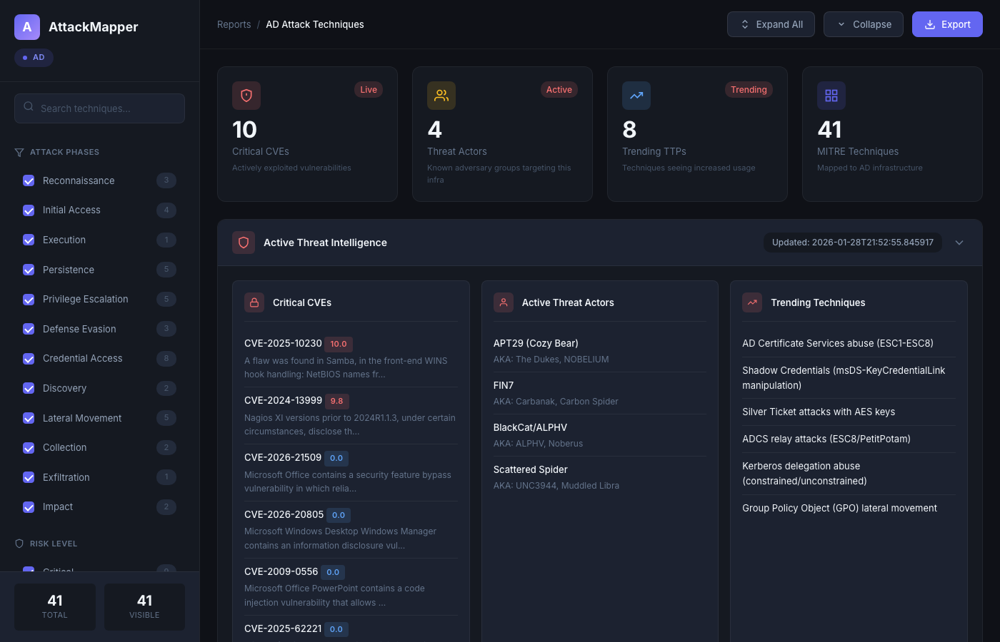

<p align="center">
  
  
  
  
  
</p>

<h1 align="center">AttackTrace</h1>

<p align="center">
  <b>External Attack Surface Management Platform</b>
</p>

<p align="center">
  A full-stack web platform for external attack surface discovery, vulnerability scanning, and team-based security management. Point it at a domain and get a complete picture of your external footprint — subdomains, exposed services, vulnerabilities, cloud assets, and more.
</p>

---

## Platform Preview

<p align="center">
  
</p>

<details>
<summary><b>More Screenshots</b></summary>

### Subdomains Discovery
<p align="center">
  
</p>

### Web Applications
<p align="center">
  
</p>

### Screenshot Gallery
<p align="center">
  
</p>

</details>

---

## Features

| Category | Capabilities |
|---|---|
| **Asset Discovery** | Subdomain enumeration, ASN/IP range mapping, certificate transparency, DNS resolution |
| **Infrastructure** | Port scanning (100+ ports), service detection, banner grabbing |
| **Web Analysis** | HTTP probing, technology fingerprinting (60+ signatures), automated screenshots |
| **Cloud** | AWS S3, Azure Blob, GCP bucket enumeration |
| **OSINT** | GitHub recon, employee discovery, leaked secrets in code |
| **Threat Intel** | Shodan, Censys, SecurityTrails, AlienVault OTX, GreyNoise, URLScan |
| **Vulnerability Scanning** | Nuclei integration with CVE/CVSS enrichment from NVD |
| **Fuzzing** | ffuf integration with wordlist picker and live progress |
| **Network** | Nmap scanner with 7 scan types and parsed results |
| **Takeover Detection** | Subdomain takeover checker via CNAME chain analysis |
| **Findings** | Severity triage, status workflow, CVE linking, bulk operations |
| **Reports** | Auto-generated HTML reports per scan |
| **Team** | Multi-user, invite codes, role-based access (Owner / Admin / Analyst / Viewer) |

---

## Stack

| Layer | Technology |
|---|---|
| Backend | FastAPI + SQLAlchemy (async) |
| Frontend | Next.js 15 + React 19 + Tailwind CSS |
| Task Queue | Celery + Redis |
| Database | PostgreSQL |
| Scan Engine | AttackTrace Python CLI + nuclei + ffuf + nmap |

---

## Installation

Choose the method that works for your environment.

---

### Option A — Without Docker (recommended for most users)

**Prerequisites:** Python 3.11+, Node.js 18+, PostgreSQL, Redis

Install prerequisites on macOS:
```bash
brew install python@3.11 node postgresql@16 redis
brew services start postgresql@16
brew services start redis
```

Install prerequisites on Ubuntu/Debian:
```bash
sudo apt update && sudo apt install -y python3.11 python3.11-venv nodejs npm postgresql redis-server
sudo systemctl start postgresql redis-server
```

**Then:**

```bash
git clone https://github.com/BaymaxPop23/AttackTrace.git
cd AttackTrace
chmod +x start.sh && ./start.sh
```

Or using Make:
```bash
make start
```

The script will:
1. Create a Python virtual environment and install all dependencies
2. Install frontend Node modules
3. Generate a `.env` with random secrets
4. Create the PostgreSQL database and user
5. Run database migrations
6. Create the default admin account
7. Start backend, Celery worker, Celery beat, and Next.js

**Stop all services:**
```bash
./stop.sh   # or: make stop
```

---

### Option B — With Docker

**Prerequisites:** [Docker Desktop](https://docs.docker.com/get-docker/) (includes Compose)

```bash
git clone https://github.com/BaymaxPop23/AttackTrace.git
cd AttackTrace
chmod +x setup.sh && ./setup.sh
```

Or using Make:
```bash
make setup
```

**Stop:**
```bash
make down
```

---

### Log in

Once running, open **http://localhost:3000**

| Field | Value |
|---|---|
| Username | `admin` |
| Password | `Ihate13$` |

---

### Install scanning tools (optional but recommended)

To use Nuclei, ffuf, Nmap, and other scanners:

```bash
make install-tools
```

Installs: `nuclei`, `ffuf`, `nmap`, `gowitness`, `SecLists`, `nuclei-templates`, and Playwright browsers.

---

## Updating

Pull the latest changes from GitHub and restart:

**Without Docker:**
```bash
git pull && ./start.sh
```

**With Docker:**
```bash
make update
```

Both automatically run new database migrations before restarting.

---

## Useful Commands

```bash
# Native (no Docker)
make start          # Start all services
make stop           # Stop all services

# Docker
make setup          # First-time Docker setup
make update         # Pull + rebuild + restart (Docker)
make up             # Start containers
make down           # Stop containers
make logs           # Tail all container logs
make ps             # Container status

# Both modes
make migrate        # Run database migrations
make seed           # Re-run initial data seed
make install-tools  # Install nuclei, ffuf, nmap, etc.
```

---

## Inviting Team Members

1. Go to **Settings → Members**
2. Click **Generate Invite Code**
3. Choose a role and expiry
4. Copy the invite link and share it

Recipients open the link, enter their details, and join your organization automatically.

**Roles:**

| Role | Permissions |
|---|---|
| Owner | Full access, cannot be removed |
| Admin | Manage team, settings, all scans |
| Analyst | Run scans, manage findings |
| Viewer | Read-only access |

---

## API Keys (optional enrichment)

Configure third-party API keys at **Settings → Integrations** to enable enrichment modules:

| Service | Used for |
|---|---|
| Shodan | Open ports, CVEs, banners |
| Censys | Certificate & host discovery |
| SecurityTrails | Passive DNS, subdomain history |
| GitHub Token | Repo recon, secret detection |
| AlienVault OTX | Threat intelligence, IOCs |
| PassiveTotal | Passive DNS, WHOIS history |

All credentials are encrypted with AES-256-GCM before storage.

---

## Architecture

```
┌─────────────────────────────────────────────┐
│              Docker Compose                  │
│                                              │
│  ┌──────────┐    ┌──────────┐               │
│  │ Next.js  │───▶│ FastAPI  │               │
│  │ :3000    │    │ :8000    │               │
│  └──────────┘    └────┬─────┘               │
│                       │                      │
│          ┌────────────┼────────────┐         │
│          ▼            ▼            ▼         │
│     ┌─────────┐  ┌────────┐  ┌────────┐    │
│     │Postgres │  │ Redis  │  │ Celery │    │
│     │  :5432  │  │ :6379  │  │ Worker │    │
│     └─────────┘  └────────┘  └────────┘    │
└─────────────────────────────────────────────┘
```

- **Celery Worker** runs long scans asynchronously, streaming progress via Redis pub/sub
- **Celery Beat** runs a watchdog every 5 minutes to recover stuck scans
- **Flower** (Celery monitoring UI) available at http://localhost:5555/flower

---

## Troubleshooting

**Containers won't start**
```bash
make logs          # Check what's failing
make down && make up
```

**Database migration errors**
```bash
make migrate
```

**Backend not responding after update**
```bash
make backend-logs  # Check for errors
make restart
```

**Scanning tools not found (nuclei / ffuf / nmap)**
```bash
make install-tools
```

**Forgot the admin password**

Reset it directly in the database:
```bash
make db-shell
# Inside psql:
UPDATE users SET hashed_password = '<new-bcrypt-hash>' WHERE email = 'admin';
```

---

## Legal Notice

AttackTrace is intended for **authorized security testing only**. Only scan targets you own or have explicit written permission to test. Unauthorized scanning may violate computer fraud laws in your jurisdiction. The authors accept no liability for misuse.

---

## License

MIT — see [LICENSE](LICENSE) for details.
